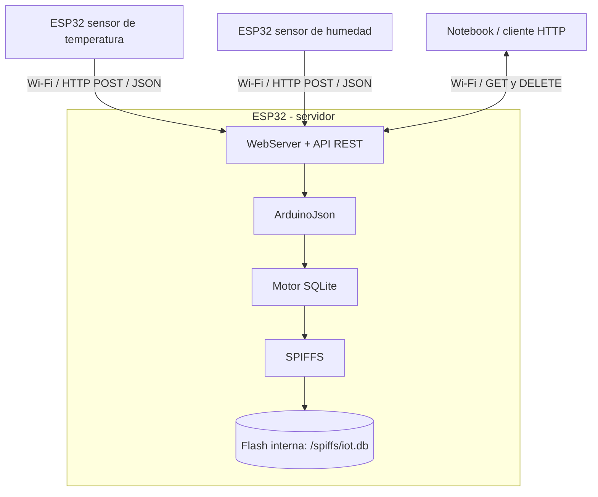

# ESP32 + SQLite + SPIFFS + API REST

### Un servidor de datos compacto, alojado íntegramente en un ESP32

Este proyecto demuestra cómo utilizar un **ESP32 (por ejemplo, un ESP32-S3)** como **servidor HTTP con API REST** y **base de datos SQLite local**, almacenada en la memoria flash del microcontrolador mediante **SPIFFS**.

El ESP32 puede recibir mediciones de otros dispositivos a través de Wi-Fi, almacenarlas y permitir que una computadora u otro cliente las consulte. **No hace falta instalar un servidor de base de datos en una PC ni contratar un servicio en la nube.**

> **Objetivo educativo / prueba de concepto (POC):** comprender cómo se integran microcontroladores, redes Wi-Fi, servicios web, JSON y bases de datos en una solución de IoT.

## ¿Qué vamos a aprender?

- Qué es **SQLite** y cómo se diferencia de un servidor de base de datos tradicional.
- Qué es una **API REST** y cómo funcionan los métodos HTTP `GET`, `POST` y `DELETE`.
- Cómo almacenar datos en la **flash interna** del ESP32 usando **SPIFFS**.
- Para qué sirven **ArduinoJson** y **esp32_arduino_sqlite3_lib**.
- Cómo enviar y consultar mediciones de sensores por la red local.

## Arquitectura de la solución



**Flujo básico:** un sensor envía un JSON por HTTP; el ESP32 servidor procesa la solicitud, valida los datos y ejecuta una operación SQLite. La base de datos se guarda en la propia flash del dispositivo.

## Componentes y tecnologías

| Componente | Función |
| --- | --- |
| **ESP32 / ESP32-S3** | Ejecuta el firmware y atiende las solicitudes HTTP. |
| **WiFi** | Conecta el dispositivo a la red local. |
| **WebServer** | Expone las rutas de la API REST. |
| **ArduinoJson** | Interpreta las solicitudes JSON y construye las respuestas. |
| **esp32_arduino_sqlite3_lib** | Integra el motor SQLite en el programa Arduino. |
| **SPIFFS** | Permite almacenar el archivo de base de datos en la flash interna. |
| **SQLite** | Crea las tablas y ejecuta consultas SQL sin un servidor externo. |

**SQLite** es una base de datos relacional embebida: guarda tablas y registros en un archivo. **SPIFFS** es el sistema de archivos que permite conservar ese archivo en la memoria flash del ESP32. Son tecnologías diferentes y complementarias.

## Requisitos

### Hardware

- Una placa **ESP32 o ESP32-S3** compatible con el firmware y con suficiente memoria flash.
- Cable USB para programarla.
- Red Wi-Fi accesible para el ESP32 y los clientes de prueba.
- Opcional: otro ESP32 con sensores, para enviar mediciones reales.

### Software

- [Arduino IDE](https://www.arduino.cc/en/software).
- Paquete de placas **esp32** de **Espressif Systems**, instalado desde *Boards Manager*.
- Biblioteca [ArduinoJson](https://arduinojson.org/), desde *Library Manager*.
- Biblioteca [esp32_arduino_sqlite3_lib](https://github.com/siara-cc/esp32_arduino_sqlite3_lib), instalada según las instrucciones de su repositorio o mediante ZIP.
- Un cliente HTTP, como `curl`, Postman o una aplicación propia.

> `WiFi`, `WebServer` y `SPIFFS` se utilizan desde el entorno Arduino para ESP32. Verificá la compatibilidad de las versiones de las bibliotecas y del paquete de placas con el sketch del proyecto.

## Preparación del ESP32

1. Instalá el soporte **esp32 by Espressif Systems** en Arduino IDE.
2. Seleccioná la placa correspondiente, por ejemplo **ESP32 Dev Module** o tu modelo ESP32-S3.
3. Instalá las bibliotecas indicadas arriba.
4. En **Tools → Partition Scheme**, elegí un esquema que reserve espacio para el firmware **y** para SPIFFS. Como ejemplo, en algunas placas de 4 MB existe **No OTA (2MB APP / 2MB SPIFFS)**; las opciones varían según la placa y el paquete ESP32.
5. Configurá las credenciales Wi-Fi en el sketch (sin publicarlas en GitHub).
6. Compilá y cargá el firmware; abrí el **Monitor Serie** para ver la dirección IP asignada.

**Importante:** el documento de esta POC describe el funcionamiento del sketch, pero no incluye su código `.ino` completo. Para que el repositorio sea reproducible, agregá el sketch del proyecto junto a este README.

## Inicio de la base de datos

En el arranque, el firmware monta SPIFFS y abre el archivo SQLite:

```cpp
SPIFFS.begin(true);
sqlite3_open("/spiffs/iot.db", &db);
```

Si el archivo no existe, SQLite puede crearlo. Luego el programa crea la tabla de datos si todavía no está definida:

```sql
CREATE TABLE IF NOT EXISTS data (
    id INTEGER PRIMARY KEY,
    device TEXT NOT NULL,
    sensor TEXT NOT NULL,
    value REAL NOT NULL,
    timestamp INTEGER NOT NULL
);
```

Esto significa que **no es necesario cargar previamente un archivo `.db`** para esta demostración. El código real debe comprobar el resultado de montaje, apertura y ejecución SQL antes de iniciar la API.

## Endpoints de la API REST

Tomamos como ejemplo la IP local `192.168.1.80`. **Reemplazala por la IP mostrada en tu Monitor Serie.**

| Método | Ruta | Descripción |
| --- | --- | --- |
| `GET` | `/api/status` | Consulta el estado del servidor. |
| `POST` | `/api/data` | Inserta una nueva medición. |
| `GET` | `/api/data` | Obtiene mediciones registradas. |
| `GET` | `/api/data?limit=10` | Limita la cantidad de registros devueltos. |
| `GET` | `/api/data/1` | Consulta una medición por ID. |
| `DELETE` | `/api/data/1` | Elimina una medición por ID. |

### 1. Comprobar el servidor

```bash
curl http://192.168.1.80/api/status
```

**Ejemplo de respuesta:**

```json
{
  "status": "ok",
  "device": "ESP32-S3 SQLite REST Server",
  "ip": "192.168.1.80",
  "heap": 286412,
  "spiffs_total": 1507328,
  "spiffs_used": 8192
}
```

Los valores de memoria son ilustrativos y cambian según el dispositivo.

### 2. Enviar una medición

```bash
curl -X POST http://192.168.1.80/api/data \
  -H "Content-Type: application/json" \
  -d '{
    "device": "esp32-01",
    "sensor": "temperature",
    "value": 24.7,
    "timestamp": 1770000000
  }'
```

**Ejemplo de respuesta:**

```json
{
  "status": "created",
  "id": 1
}
```

Los campos representan el dispositivo, el tipo de sensor, el valor leído y una marca temporal Unix en segundos. La creación del ID la gestiona SQLite.

### 3. Obtener las mediciones

```bash
curl http://192.168.1.80/api/data
```

**Ejemplo de respuesta:**

```json
{
  "data": [
    {
      "id": 1,
      "device": "esp32-01",
      "sensor": "temperature",
      "value": 24.7,
      "timestamp": 1770000000
    }
  ]
}
```

Para pedir como máximo 10 registros:

```bash
curl 'http://192.168.1.80/api/data?limit=10'
```

### 4. Consultar un registro por ID

```bash
curl http://192.168.1.80/api/data/1
```

### 5. Eliminar un registro

```bash
curl -X DELETE http://192.168.1.80/api/data/1
```

**Ejemplo de respuesta:**

```json
{
  "status": "deleted"
}
```

> Las respuestas mostradas corresponden a los ejemplos del proyecto. El comportamiento de errores y los códigos HTTP dependen de la implementación final del sketch.

## Caso de uso: varios sensores, una única base de datos

Imaginemos tres ESP32 ubicados en distintas salas de una escuela:

- Sensor de temperatura → envía mediciones con `POST /api/data`.
- Sensor de humedad → envía mediciones con `POST /api/data`.
- Sensor de presión → envía mediciones con `POST /api/data`.

Un cuarto ESP32 actúa como **servidor central** y mantiene los datos en `iot.db`. Desde una notebook se consultan mediante `GET /api/data`. Todos los equipos deben poder conectarse por red al servidor.

## Ventajas del prototipo

- No requiere una PC funcionando como servidor de base de datos.
- Permite combinar sensores, HTTP, JSON y SQL en un solo ejercicio.
- Aprovecha la memoria interna de la placa.
- Es útil para aprendizaje, pruebas de concepto y cargas de datos moderadas.

## Limitaciones y precauciones

- **Desgaste de flash:** la memoria tiene ciclos de escritura finitos. Evitá escrituras excesivamente frecuentes.
- **Concurrencia:** la biblioteca SQLite utilizada advierte limitaciones de bloqueo ante escrituras simultáneas desde múltiples tareas; organizá o serializá el acceso a la base de datos.
- **Memoria y almacenamiento:** el tamaño de la base, la cantidad de clientes y el procesamiento están limitados por el ESP32 y sus particiones.
- **Persistencia:** los registros suelen sobrevivir a reinicios normales, pero formatear SPIFFS o modificar particiones puede borrar los datos. `SPIFFS.begin(true)` puede formatear si falla el montaje.
- **Seguridad:** esta POC está concebida para una red local controlada. No expongas una API sin autenticación directamente a Internet.
- **Escalabilidad:** para grandes volúmenes de datos, escrituras intensivas o alta concurrencia, conviene evaluar un servidor o una base de datos externos.

## Presentación de la clase abierta

El proyecto cuenta con una presentación HTML interactiva que explica los conceptos, la arquitectura y las operaciones REST, e incorpora un simulador didáctico.

Archivo sugerido para incluir en el repositorio:

```text
ESP32_SQLite_API_REST_Clase_Abierta.html
```

Abrilo en un navegador moderno. La simulación funciona sin conectarse físicamente al ESP32 y **no modifica una base de datos real**.

## Estructura recomendada del repositorio

```text
esp32-sqlite-api-rest/
├── README.md
├── ESP32_SQLite_REST/
│   └── ESP32_SQLite_REST.ino        # Agregar el sketch real
└── docs/
    └── ESP32_SQLite_API_REST_Clase_Abierta.html
```

> La estructura es una recomendación de organización, no una afirmación de que los archivos de código ya estén incluidos.

## Posibles mejoras

- Incorporar una interfaz web con gráficos históricos.
- Agregar autenticación y validación estricta de las solicitudes.
- Registrar datos desde sensores reales y permitir filtrarlos por dispositivo o fecha.
- Implementar una estrategia de respaldo o envío periódico a un servidor externo.
- Medir el uso de memoria, los tiempos de consulta y el impacto de las escrituras.

---

**Proyecto educativo:** ESP32 + SQLite + API REST · Arduino IDE · IoT
